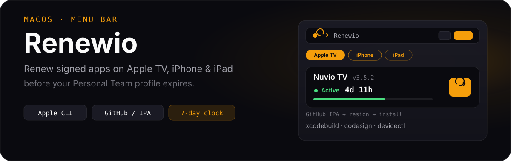
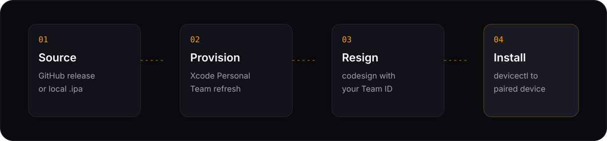

<p align="center">
  
</p>

**Renewio** is a native macOS menu bar app for keeping Personal Team–signed apps alive on paired **Apple TV**, **iPhone**, and **iPad**.

It pulls an unsigned IPA from **GitHub** (or a **local `.ipa`**), refreshes your Xcode signing profile with Apple’s own CLI tools, resigns, installs, and tracks the real expiry countdown per app.

---

<p align="center">
  
</p>

### Why it exists

Free / Personal Team signing expires on a short clock. Renewio turns that into a menu-bar habit: see what’s running out, renew from the same window, optionally auto-renew when the device is nearby.

| You bring | Renewio does |
| --- | --- |
| Xcode + paired device | Finds Team ID, devices, and installed SDKs |
| GitHub repo or local IPA | Downloads / caches releases (keeps latest 3) |
| One click **Renew** | `xcodebuild` → `codesign` → `devicectl` |
| Menu bar glance | Live countdown, expiry notifications, renew-all |

No Sideloadly. Apple CLI only.

---

<p align="center">
  
</p>

### Requirements

- macOS 14+
- Xcode with tvOS and/or iOS platforms
- Apple ID signed into **Xcode → Settings → Accounts**
- Device paired in **Xcode → Window → Devices and Simulators**

### Install

Download the latest `.dmg` from **[Releases](https://github.com/vishnubapana/Renewio/releases)**, open it, and drag **Renewio** into Applications.

Or build from source:

```bash
./scripts/install-renewio.sh
open -a Renewio
```

Rebuild only:

```bash
./scripts/build-renewio.sh
open dist/Renewio.app
```

---

<p align="center">
  
</p>

1. Click the menu bar icon → **Settings** (gear)
2. Confirm **Team ID** (auto-detected when possible)
3. Add a paired Apple TV / iPhone / iPad
4. **Add app** — paste a GitHub HTTPS clone URL, or pick / drop a local `.ipa`
5. **Save**, then **Renew** on the app card (or **Renew all**)

Optional in Settings: **Launch at login**, **Auto-renew when nearby**, and a Keychain-stored **GitHub token** for private repos / higher API limits.

---

### What “Renew” runs

`scripts/renewio.sh` (also bundled in the app):

1. Checks the device with `xcrun devicectl`
2. Fetches the GitHub release (or uses `--tag` / `--ipa`)
3. Builds a provisioning stub with `xcodebuild -allowProvisioningUpdates` and reads the real profile `ExpirationDate`
4. Patches the bundle ID, resigns with `codesign`
5. Installs with `xcrun devicectl device install app`

Config: `~/Library/Application Support/Renewio/config.json`  
Logs: `~/Library/Logs/Renewio/`

---

### Project layout

| Path | Role |
| --- | --- |
| `Renewio/` | SwiftUI `MenuBarExtra` app |
| `scripts/renewio.sh` | Download / sign / install pipeline |
| `scripts/build-renewio.sh` | Release build → `dist/` |
| `scripts/install-renewio.sh` | Build, install to `/Applications`, create DMG |
| `assets/readme/` | README visuals |

---

### Limits

- Personal Team signing still follows Apple’s rules and expiry windows
- Devices must stay paired and reachable for install / auto-renew
- Private GitHub sources need a token in Settings
- Ad-hoc signed local builds; Gatekeeper may require a right-click → Open the first time

### License

Personal / private use unless otherwise noted.
